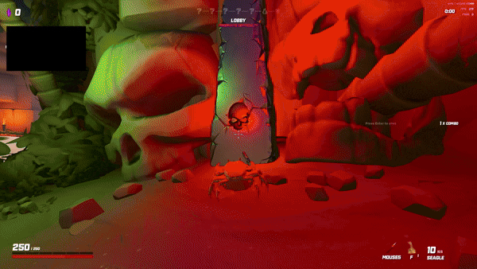

# Crab Champions Mods

[UE4SS](https://github.com/UE4SS-RE/RE-UE4SS/releases) Lua mods for **Crab Champions**, by AutoComput.

## Mods

| Mod | What it does | Version |
|---|---|---|
| [CancelLockedSlots](CancelLockedSlots/README.md) | Keep **Locked Slots** selected for real Prismatic rank, loot luck and victory rewards, while cancelling its effect so your inventory keeps normal slot counts. | 1.0.0 |

Each mod folder has its own `README.md` (install, settings, troubleshooting) and `CHANGELOG.md`.

### CancelLockedSlots



## Requirements

- Crab Champions (Steam)
- UE4SS, tested with **UE4SS 3.0.1** on Crab Champions' Unreal Engine 4.27 build

## Installing a mod

Download the mod's release zip and extract it into:

```
Crab Champions\CrabChampions\Binaries\Win64\ue4ss\Mods\
```

Each zip contains a single `<ModName>\` folder with an `enabled.txt`, so the mod turns itself on without editing `mods.txt`. See the mod's own README for details.

## Releasing

Releases are automated. Tagging a mod builds and publishes it:

```bash
git tag -a cancel-locked-slots/v1.0.0 -m "CancelLockedSlots v1.0.0"
git push origin cancel-locked-slots/v1.0.0
```

The [Release workflow](.github/workflows/release.yml) then builds the zip on a
Windows runner, writes the release notes from that mod's `CHANGELOG.md`, and
attaches `<ModName>-v<version>.zip` to a new GitHub Release.

Tags are namespaced `<mod-slug>/vX.Y.Z`, since each mod ships on its own
schedule. The slug is the mod folder name in kebab-case, so
`cancel-locked-slots` resolves to the `CancelLockedSlots/` folder.

The workflow refuses to publish if:

- the tag is not in `<mod-slug>/vX.Y.Z` form
- no mod folder matches the slug
- the tag version disagrees with `modVersion` in that mod's `scripts\main.lua`
- that mod's `CHANGELOG.md` has no matching `## <version>` entry

### Building locally

To produce the same zip without publishing:

```powershell
powershell -ExecutionPolicy Bypass -File .\build-release.ps1 -Mod CancelLockedSlots
```

Output lands in `dist\<ModName>-v<version>.zip`. Personal `config.lua` files and
`.log` files are never shipped. You can also run the workflow manually from the
Actions tab to build a zip as a downloadable artifact without creating a release.

## Reporting a problem

Open an issue and say which mod it's about. Most mod folders include `tools\CollectDiagnostics.bat`, which bundles the relevant logs — attach the zip it produces.

## Disclaimer

This is an unofficial, fan-made modification. It is not affiliated with,
endorsed by, sponsored by, or associated with Crab Champions or its creator,
Noisestorm.

Crab Champions, and all related names, artwork, assets and trademarks, are the
property of their respective owners. All rights reserved by those owners. This
mod contains no game assets; it only changes behaviour at runtime on the
player's own machine.

This mod is provided free of charge, as is and without warranty of any kind.
Use it at your own risk.

## License

Copyright (C) 2026 AutoComput. Licensed under the GNU General Public License v3.0 or later (`GPL-3.0-or-later`). See [`LICENSE`](LICENSE).
